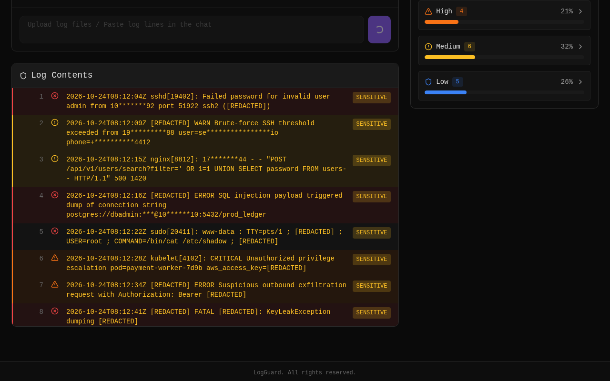
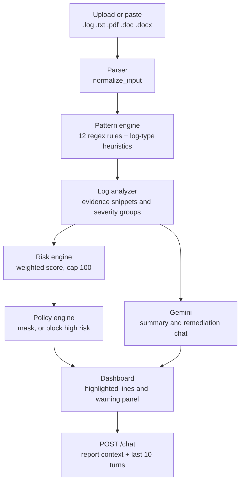

# LogGuard

[](https://www.python.org/)
[](backend/main.py)
[](frontend_v2/package.json)
[](LICENSE)
[](https://log-guard-silk.vercel.app/)

LogGuard is a security-log triage desk for operators who need a deterministic first pass before any model call. It parses `.log`, `.txt`, `.pdf`, `.doc`, and `.docx` uploads, flags secrets and PII with line-level evidence, scores each hit `Critical` / `High` / `Medium` / `Low`, masks the values in the viewer, and asks Google Gemini for a root-cause summary plus follow-up remediation answers.

The recording below is the live walkthrough: upload `prod_security_audit.log` (1.28 KB), classify the file, read the masked lines, and ask which leaked credentials need rotation.

<p align="center">
  
</p>

<p align="center">
  
</p>

## Overview

Security and platform teams still triage incidents by opening raw server logs in an editor. A single export mixes failed SSH attempts, application errors, connection strings, tokens, and customer PII. Sending that file straight to an LLM is slow, expensive, and hard to audit: the model sees secrets it does not need, and the operator cannot tell which lines were actually matched.

LogGuard splits the job in two.

1. A local, deterministic pipeline parses the file, runs regex and log-type heuristics, assigns a severity, and applies a redaction policy. This path is what lights up the line highlighter and the warning panel.
2. Gemini receives the compact analyzer context (finding types, severities, line numbers, and clipped evidence snippets) and writes the narrative: what leaked, why it matters, and what to rotate. The chat panel reuses the on-screen report for follow-up questions.

The dashboard the operator sees is already masked. `processed_content` replaces secrets according to each rule's redaction hint (`[REDACTED]`, partial masks, last-four phone digits, or `***` inside a database URL) before `LogViewer` paints a line. Matched values remain inside the insight prompt so the summary can name the leak. Keep `GEMINI_API_KEY` on the server and treat the Gemini project as a trusted processor.

## System architecture



`POST /analyze` and `POST /analyze/upload` in `backend/main.py` run the same stages and return findings, `risk_score`, `risk_level`, policy `action`, `insights`, masked `processed_content`, and timing metadata.

### 1. Multi-format ingestion and parsing

`backend/parser.py` (`normalize_input`) turns every accepted input into numbered lines and 50-line chunks.

| Input | Extraction |
| --- | --- |
| `text`, `log`, `sql`, `chat` | Inline text. `log` is tagged `content_type=logs`. |
| `.log`, `.txt`, `.sql`, `.csv`, `.json` | UTF-8 decode, with a Latin-1 fallback and a `decoded_non_utf8_text` warning. |
| `.pdf` | `pypdf` page text. |
| `.docx` | `python-docx` paragraphs. |
| `.doc` | Best-effort: try the docx parser, then printable-string recovery. |

The upload route reads the multipart file, base64-wraps it, and reuses that parser. Empty files return HTTP 400 `empty_file`. Unsupported extensions return `unsupported_file_type`. The UI accepts `.log`, `.txt`, `.pdf`, `.doc`, and `.docx` (`frontend_v2/src/app/components/FileUpload.tsx`). Pasting log-shaped text into chat (a newline, or an HTTP method / status / IP pattern) takes the same analyze path with `input_type=log`.

Local medians on Python 3.12, repeated after a warmup, stay under **1.2 s/MB**:

| Stage | Sample | Median |
| --- | --- | --- |
| `normalize_input` on a `.log` payload | 1.00 MiB, 12,858 lines | 0.007 s (0.007 s/MB) |
| `analyze_log_lines` (detect, group, classify) | same 1.00 MiB access log, a secret line every 80 lines | 0.36 s (0.36 s/MB) |
| PDF extract via `pypdf` | 100 pages, 0.31 MiB of extracted text | 0.30 s (0.96 s per extracted MB) |

These are single-machine measurements of the deterministic path, not a hosted SLA. PDF time tracks extracted text size. The Gemini call sits outside this budget.

### 2. Deterministic threat and secret detection

`backend/patterns.py` scans each line with a fixed rule table. `api_key` and `bearer_token` matches shorter than 14 characters are dropped. Every hit carries `type`, `value`, `risk`, `confidence`, `redaction_hint`, and `line`.

| Rule | Severity | Confidence | What it matches | Redaction |
| --- | --- | --- | --- | --- |
| `password` | Critical | 0.95 | `password`, `passwd`, `pwd`, or `passphrase` assignments | `[REDACTED]` |
| `private_key` | Critical | 1.00 | `BEGIN RSA/EC/OPENSSH/PRIVATE KEY` blocks | `[REDACTED]` |
| `connection_string` | Critical | 0.95 | `postgres` / `mysql` / `mongodb` / `redis` URLs with embedded credentials | password replaced with `***` |
| `jwt` | High | 0.85 | three-segment `eyJ…` tokens | `[REDACTED]` |
| `bearer_token` | High | 0.90 | `Authorization: Bearer …` | `[REDACTED]` |
| `api_key` | High | 0.88 | `api_key`, `x-api-key`, or `client_secret` assignments | `[REDACTED]` |
| `aws_access_key` | High | 0.92 | AWS access key IDs (`AKIA` / `ASIA` plus 16 characters) | `[REDACTED]` |
| `phone` | Medium | 0.65 | NANP-style phone numbers | all but the last 4 digits |
| `stack_trace` | Medium | 0.70 | Python tracebacks, Java `at class.method(File.java:N)`, thread exceptions | unchanged |
| `internal_ip` | Medium | 0.70 | RFC1918 addresses | keep first 2 and last 2 characters |
| `email` | Low | 0.75 | mailbox addresses | keep first 2 and last 2 characters |
| `hostname` | Low | 0.55 | names ending in `.internal`, `.local`, `.corp`, or `.lan` | unchanged |

A second heuristic, `identify_log_type`, scores the file against six families and returns the best match with a confidence of `min(1, hits / (line_count × 0.2))`:

| `log_type` | `log_sub_type` | Signals |
| --- | --- | --- |
| `web_server_access` | `nginx_apache_access` | quoted HTTP methods, status/size pairs, nginx/apache |
| `linux_syslog` | `system_auth_kernel` | syslog timestamps plus `sshd`, `sudo`, `systemd`, or `kernel` |
| `application_structured_json` | `json_lines` | JSON objects with `level`, `timestamp`, `message`, or `msg` |
| `web_server_error` | `http_error_trace` | `ERROR` / `WARN` / `CRITICAL` / `FATAL` plus stack language |
| `database` | `sql_nosql_engine` | `postgres`, `mysql`, `mongodb`, `redis`, `sqlstate`, `query` |
| `container_kubernetes` | `container_runtime_or_k8s` | `kubelet`, `kubectl`, `pod`, `containerd`, `docker` |

Attack text in a line (an SSH failure, a SQL payload, a `sudo` to root, a kubelet privilege-escalation message) is preserved as evidence. The regex engine anchors that line when a secret or PII rule matches it. It does not emit separate labels such as `sql_injection` or `ssh_bruteforce`. The Gemini summary is what turns those lines into an incident narrative. `backend/log_analyzer.py` then attaches an evidence snippet (clipped at 180 characters) and groups hits by type and severity.

### 3. Severity triage and scoring

`backend/risk_engine.py` weights each finding and caps the total at 100.

| Severity | Weight |
| --- | --- |
| Critical | 10 |
| High | 6 |
| Medium | 3 |
| Low | 1 |

The document level is `critical` when any critical finding exists or the score is at least 30, `high` when there are at least two high findings or the score is at least 18, `medium` when there are at least two medium findings or the score is at least 8, and `low` otherwise.

`backend/policy_engine.py` then masks in place. With `block_high_risk=true` and a document level of `high` or `critical`, the action is `blocked`, `processed_content` is empty, and the warning is `Request blocked by policy due to high-risk findings.` The default UI sends `mask=true` and `block_high_risk=false`, so the operator sees redacted lines rather than an empty viewer.

The React app colors each affected line (red, orange, amber, blue), badges it `SENSITIVE`, and rolls the same four counts into the warning panel with a share of total findings.

### 4. Root-cause analysis and conversational triage

`backend/ai_insights.py` calls `google.genai` `models.generate_content` with temperature `0.2` and `max_output_tokens=1400`. The default model is `gemini-1.5-flash` (`GEMINI_MODEL` overrides it). Markdown emphasis is stripped so the panel stays plain text.

- `generate_insights` summarizes the analyzer context for the AI Summary panel.
- `generate_chat_response` answers a question using that report plus conversation history. The UI sends the last 10 turns and the on-screen report (`fileName`, masked log lines, warnings, severity counts, AI summary).

Missing `GEMINI_API_KEY` returns `AI summary unavailable: GEMINI_API_KEY is not configured.` and `Chat assistant unavailable: GEMINI_API_KEY is not configured.` A failed model call returns the matching `model call failed` string. If the browser cannot reach `POST /chat` at all, `frontend_v2/src/app/api.ts` answers from the local report (highest-severity warning, top three warnings, a requested line number, or the severity totals).

## Results and detection benchmarks

### Gold-label contract

`backend/tests/fixtures/gold_labels_1000.json` is the checked-in contract for a 1,000-line web-access log (`web_server_access` / `nginx_apache_access`). The expected set is **14 findings on 12 lines**:

| Severity | Count | Labels |
| --- | --- | --- |
| Critical | 3 | `password`, `connection_string`, `private_key` |
| High | 4 | `api_key`, `bearer_token`, `jwt`, `aws_access_key` |
| Medium | 3 | `stack_trace`, `internal_ip`, `phone` |
| Low | 4 | `email` (2), `hostname` (2) |

`backend/tests/test_evaluation_metrics.py` requires precision of at least **92%**, recall of **100%**, and at most one false positive on the `(type, line)` pairs. The analyzer assertion also requires `total_findings == 14` and the severity histogram above. Those two checks together leave no unmatched label and no extra hit, so a fully green evaluation file is an exact match: 100% precision and 100% recall. The 1,000-line log itself is not in git because `.gitignore` ignores `*.log`; place it at `backend/tests/fixtures/gold_logs_1000.log` before expecting that module to pass.

### Live audit walkthrough

The GIF and the still are the same session against `prod_security_audit.log` (1.28 KB). The assistant message in the recording reports **19 warnings: 4 critical, 4 high, 6 medium, 5 low**. The viewer shows those lines already masked, each marked `SENSITIVE`:

| Line theme in the recording | What the deterministic pass locks onto |
| --- | --- |
| `sshd` failed password for an invalid user | `password` (Critical), plus syslog shape for `linux_syslog` |
| Brute-force SSH threshold warning with a phone number | `phone` (Medium), password material redacted on the line |
| nginx `POST` whose query string carries `' OR 1=1 UNION SELECT` | secret and PII rules on that request; the SQL text stays in the snippet for the write-up |
| Error stating a SQL payload dumped a `postgres://` URL | `connection_string` (Critical), userinfo masked |
| `sudo` from `www-data` to `root` running `cat /etc/shadow` | privilege-escalation evidence in the line; secret rules redact the rest |
| `kubelet` unauthorized privilege escalation with an AWS key | `aws_access_key` (High) |
| Outbound exfiltration with `Authorization: Bearer` | `bearer_token` (High) |
| `KeyLeakException` while dumping a private key | `private_key` (Critical) |

The AI Summary in that session calls out the password hits, the database URL, the RSA private key, the API key, and the AWS access key. The follow-up typed in chat is: "Which leaked credentials and SQLi vectors need immediate rotation?"

## Tech stack

| Layer | Choice |
| --- | --- |
| API | FastAPI  (`backend/main.py`, app version `0.1.0`), Uvicorn, Pydantic |
| Parsing | `pypdf`, `python-docx`, stdlib `base64` / `json` |
| Detection | Python `re` rules and log-type heuristics in `backend/patterns.py` |
| Policy | In-process masking and optional high-risk blocking |
| Model | `google-genai`, default `gemini-1.5-flash` |
| UI | React 18, Vite 6, Tailwind CSS 4, MUI, Radix, Lucide |
| Packaging | `Dockerfile` (Python 3.11, backend only), `railway.toml` start command |
| Tests | `pytest` under `backend/tests/` |

`requirements.txt` also lists `slowapi`, `sse-starlette`, `structlog`, and `prometheus-client` for later operational work. The current API process does not mount them.

## Project structure

```
backend/
  main.py            # /health, /analyze, /analyze/upload, /chat
  parser.py          # multi-format normalize_input
  patterns.py        # regex catalog and log-type heuristics
  log_analyzer.py    # line evidence, groups, profile
  risk_engine.py     # weighted score and document level
  policy_engine.py   # mask and optional block
  ai_insights.py     # Gemini summary and chat
  tests/             # parser, patterns, analyzer, risk, policy, insights, gold labels
frontend_v2/
  src/app/App.tsx
  src/app/api.ts     # upload, paste, and chat clients
  src/app/components # FileUpload, LogViewer, InsightsPanel, ChatInterface
docs/assets/         # README preview PNG and walkthrough GIF
Dockerfile
railway.toml
requirements.txt
.env.example
```

## API

Base URL defaults to `http://localhost:8000`. The browser reads `VITE_API_BASE_URL`.

### `GET /health`

```json
{ "status": "ok", "service": "logguard-backend" }
```

### `POST /analyze`

```json
{
  "input_type": "log",
  "content": "password=supersecret\n",
  "options": { "mask": true, "block_high_risk": false, "log_analysis": true }
}
```

`input_type` is one of `text`, `file`, `sql`, `chat`, `log`. For `file`, `content` is a JSON string with `file_name` and either `content_base64` or `text`.

### `POST /analyze/upload`

Multipart form: `file`, plus optional `mask` (default `true`), `block_high_risk` (default `false`), and `log_analysis` (default `true`).

Both analyze routes return:

| Field | Meaning |
| --- | --- |
| `findings` | Line-aware pattern hits, with `evidence_snippet` when log analysis is on |
| `risk_score`, `risk_level` | Weighted score (0–100) and document level |
| `action` | `masked`, `none`, or `blocked` |
| `processed_content` | Policy output. Empty when blocked |
| `insights` | One Gemini summary string, or the fallback sentence |
| `metadata` | `request_id`, `processing_time_ms`, `line_count`, `chunk_count`, `log_type`, `log_sub_type`, `log_profile`, `grouped_findings`, `risk_breakdown`, `warnings` |

Parser failures return HTTP 400 with `{ "code", "message" }`.

### `POST /chat`

```json
{
  "message": "Which credentials should be rotated first?",
  "report_id": "report_1",
  "report": {},
  "history": [{ "role": "user", "content": "..." }]
}
```

Response: `{ "response": "..." }`.

## Running tests

From the repository root, with the virtualenv activated:

```bash
python -m pytest backend/tests -q
```

Targeted suites:

```bash
python -m pytest backend/tests/test_patterns.py backend/tests/test_parser.py backend/tests/test_log_analyzer.py backend/tests/test_risk_policy.py backend/tests/test_ai_insights.py -q
python -m pytest backend/tests/test_evaluation_metrics.py -q
```

The evaluation module reads `backend/tests/fixtures/gold_logs_1000.log`. That path is gitignored (`*.log`), so add the fixture locally before running it. Insight tests stub Gemini and do not call the network.

## Local setup

Requires Python 3.11+ and Node.js (current LTS) with npm.

### Backend

```bash
python -m venv .venv
source .venv/bin/activate
pip install -r requirements.txt
cp .env.example .env
```

Set `GEMINI_API_KEY` in `.env`. `GEMINI_MODEL` defaults to `gemini-1.5-flash`. The process loads the repo-root `.env` and, if present, `backend/.env`.

```bash
python -m uvicorn backend.main:app --reload --host 0.0.0.0 --port 8000
```

Interactive docs: `http://localhost:8000/docs`.

### Frontend

```bash
cd frontend_v2
cp .env.example .env
npm install
npm run dev
```

`frontend_v2/.env` should contain `VITE_API_BASE_URL=http://localhost:8000`. The dev server prints its URL (Vite's default is `http://localhost:5173`). Production bundle:

```bash
npm run build
```

### Docker

The image runs the API only.

```bash
docker build -t logguard .
docker run --env-file .env -p 8000:8000 logguard
```

`railway.toml` starts the same Uvicorn command on `$PORT`.

## License

MIT. See [LICENSE](LICENSE).
